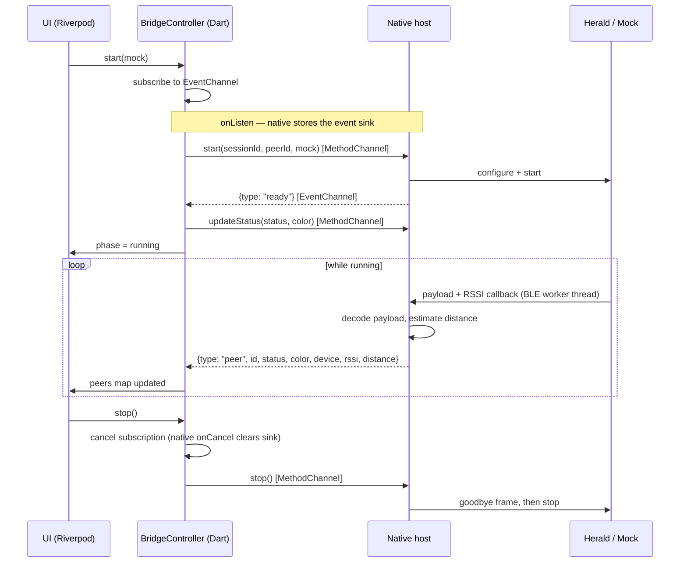
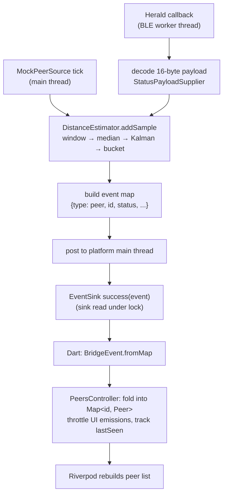

# Architecture

This document explains how the bridge is designed and why. The
[channel contract](channel-contract.md) specifies the exact wire details;
the [Android](android.md) and [iOS](ios.md) docs cover platform specifics.

## The two-channel design

Flutter ↔ native communication here has two very different shapes:

1. **Commands**: Dart tells the native side to do something and wants an
   answer (or an error). Request/response. Low frequency.
2. **Telemetry**: the native side discovers peers continuously and pushes
   them to Dart. Fire-and-forget. High frequency, bursty, starts and stops
   with the BLE stack.

Forcing both through one mechanism produces either polling (commands-only)
or awkward fake "responses" (stream-only). So the bridge uses one
`MethodChannel` for commands and one `EventChannel` for the stream — each
channel does the one thing it is good at.

## The ready handshake

`start` returning success only means the native side *accepted* the request
— BLE initialization continues asynchronously. Dart must not push payload
updates into a half-initialized native stack, so readiness is signaled
explicitly with a `{type: "ready"}` event.

Two orderings are possible, and both must work:

- **Dart subscribes first** (the normal path): the controller subscribes to
  the event stream *before* invoking `start`, so the ready event cannot slip
  through the gap.
- **Native is ready first** (hot restart, or the app reopened while the
  native side kept running): the native `onListen` checks whether a source is
  already running and *re-sends* ready to the new subscriber.

This "ready replay" makes the handshake immune to subscribe/start races
from either direction. Dart additionally puts a timeout on the wait so a
genuinely failed native start surfaces as an error instead of a hang, and
fails the wait immediately if the event stream reports an error first.

## The sighting pipeline

Everything from "a peer was observed" onward is one code path, regardless
of whether the observation came from Herald or from the mock source:

This is the property that makes mock mode honest: it does not bypass the
bridge, it feeds it. If the threading, locking, codec, or channel plumbing
were broken, mock mode would break too.

## Distance estimation

Raw BLE RSSI at a fixed distance jitters by several dB from reflections,
body shadowing, and radio quirks. The pipeline tames it in three stages,
per peer:

1. **Sliding window** — keep up to 20 samples from the last 30 seconds.
2. **Median** — robust against single-sample outliers (a person walking
   between the phones).
3. **1-D Kalman-style filter** — smooths the median over time. Unlike the
   textbook filter it has no fixed process noise: its uncertainty grows in
   proportion to how far the estimate just moved, so a steady signal is
   smoothed ever more heavily while a real jump re-opens the gain over a
   dozen or so samples (on top of the median's own lag).

The smoothed RSSI is then mapped to a coarse bucket — *Immediate* (0.5 m),
*Near* (1.5 m), *Medium* (3.5 m), *Far* (8 m) — using cutoffs chosen by the
**sender's** platform: iPhone radios read noticeably hotter than typical
Android radios at the same distance, which is why the sender's device kind
travels inside the payload. An estimate is produced from the very first
sample, so a sighting carries a `distance` exactly when it carries an `rssi`.

Buckets, not meters with decimals, are the honest output: BLE RSSI simply
does not contain centimeter-level information.

A peer's model is dropped on its goodbye, at a stop, and 120 s after its
last RSSI sample. The last matters in a crowd and over long sessions: a
peer that walks away sends no goodbye, and without it every passer-by
would keep a model, and a line in every stats log, until the bridge stops.
120 s is longer than Dart's longest eviction window (90 s), and a peer that
comes back later starts a fresh model.

## Stopping is a protocol problem

The hardest bug this bridge handles: **stopping a BLE stack is not a clean
operation, and pretending it is produces ghosts.** Two facts, verifiable in
Herald 2.2.0's source and CoreBluetooth's API surface:

1. **Live connections outlast stop.** On iOS, Herald keeps its GATT
   connections to iOS peers open for continuous RSSI, and reports every RSSI
   reading together with the payload it last read from that peer. A stopped
   iPhone cannot shed the peers connected to it: `CBPeripheralManager` has no
   API to disconnect an inbound central, and Herald's transmitter `stop()`
   only stops advertising and its keep-alive notifications — the GATT service
   stays published and keeps answering payload reads. Herald's receiver-side
   cleanup (stop scanning, disconnect peripherals) is guarded by
   `central.isScanning` and skipped entirely when scanning was not active at
   that moment — Bluetooth not yet on, a stop before the first scan, a second
   stop. Because the enabled flag is cleared first, scanning never resumes,
   so retrying stop cannot help.
   Result: a peer connected to a "stopped" iPhone keeps re-reading its
   payload over the surviving link (every `payloadDataUpdateTimeInterval`,
   15 s here), gets an answer each time, and reports each read as a sighting
   — so the stopped iPhone never goes stale. (RSSI readings on that link do
   stop: Herald's iOS receiver takes them when the peer's transmitter sends a
   keep-alive notification, and a stopped transmitter sends none.)
2. **Rebuilding the stack races its own teardown.** Herald creates its
   CoreBluetooth managers with fixed state-restoration identifiers, and its
   stop is partial (above). Creating a second `SensorArray` while the first
   is still unwinding means two stacks with managers claiming the same
   identifiers, competing for the same radio and the same peers — the
   classic "stop, start, now nothing is discovered" failure.

The bridge therefore never fights the BLE layer. It applies two patterns:

**PATTERN: single long-lived BLE host.** The Herald `SensorArray` is created
once and reused: logical stop calls `stop()` on it, logical start calls
`start()` on the *same instance*. Herald supports this — its `start()` and
`stop()` toggle enabled flags (its logs describe the receiver as "enabled to
follow bluetooth state") and a stopped array can be started again. The host
is only rebuilt when the session id changes (the advertised service UUID
must change with it), or on Android when the service hosting it is
destroyed. While logically stopped, native callbacks are not reported (a
source-mode flag gates them), because surviving connections keep delivering
measurements. They still go through `FrameOverrides` (below), since
Herald's cached payloads outlive the stop: a frame or read that arrives
meanwhile still applies after the next start.

**PATTERN: protocol-level goodbye/hello.** Since the radio cannot be
trusted to make us disappear, the *protocol* does it. The payload carries an
offline flag; on stop the device sets it and pushes the flagged payload to
its peers via Herald's immediate-send channel (`immediateSendAll` — public
API), then quiesces the host once the frames are out. Receivers translate
the flag into a `{type: "gone"}` event and remove the peer instantly. On
restart, an online hello reverses it, where it can be delivered (an
iPhone's usually cannot; see below).

**PATTERN: a frame outvotes the cached payload.** A frame is pushed exactly
because the receiver's copy of the payload is out of date — but Herald does
not update that copy from a frame. It keeps handing over every RSSI reading
together with the payload it last *read*, until its next re-read. Taken at
face value, that stale copy overrules the frame on the very next reading: a
peer that just said goodbye comes back with its old online payload (it is
still advertising for a moment while it winds down), and a peer that just
said hello is removed again by the offline payload cached while it was
stopped. The pipeline therefore tracks where each payload came from
(`FrameOverrides`): after a frame from a peer, payloads Herald only *holds*
for that peer — the one attached to an RSSI reading, or a relayed copy — are
replaced by what the frame said. A fresh read of the peer's payload ends the
override, since it is newer than the frame (a read the frame overtook is
caught by its revision, below); so does a timeout, in case that read never
happens. The timeout is two refresh intervals (30 s),
except for a goodbye from an iPhone, which lasts 5 s: an iPhone stops
advertising and sending keep-alive notifications 0.3 s after its goodbye
(one keep-alive Herald already scheduled can still follow within 2 s), so
apart from relayed copies (see [Known limitations](#known-limitations))
only readings already under way can carry its old online payload, and
holding the goodbye longer would hide the iPhone if it came back before
the next re-read — its hello usually cannot say so (below). An Android
sender keeps advertising while its blocking send works through its peers,
so its goodbye keeps the full timeout.

**PATTERN: payload revisions.** Arrival order cannot tell an old payload
from a new one. A goodbye can arrive late: Herald for Android keeps a frame
it failed to deliver and writes it on its next connection to that peer. A
read taken just before a goodbye can be delivered just after it: Herald's
iOS receiver routes reads through one more queue than frames. And a relay
can hold any older copy. So from protocol version 3 every payload carries a
7-bit revision that the sender bumps whenever its payload changes
([channel-contract.md](channel-contract.md#wire-payload-ble)). A receiver
remembers the newest revision each peer sent it in a frame or a payload
read, for 60 s after it last arrived that way, and while it remembers it,
drops any frame or read older than it. Cached copies never count towards
that memory: Herald's own repeats the payload it last read, and a relay's
can be older still, so letting them refresh it would keep an old revision
alive for as long as readings repeat it. A cached copy older than the
newest is described by the newest payload when that one is online, and
dropped when a fresh read said offline. Only when the newest is an offline
frame whose timeout has passed is the older cached copy believed: readings
then most likely mean the peer restarted and its hello was lost. Peers on
builds before version 3 send no revision and get the timeout rule alone.

A late goodbye is only caught if the receiver has already read the newer
payload. Herald for Android replaces a stuck frame with the next one it
sends, so a goodbye arrives late only at a peer the restart's hello
skipped: one the sender had not seen for a minute. That peer could not read
the stopped sender either, so it has normally forgotten the old revision.
If the late goodbye reaches it before its first read of the restarted
sender, the goodbye is believed, and the sender stays hidden there until
that read or the goodbye's 30 s timeout. Which of the two comes first
depends on radio timing and was not measured.

Revisions only order the payloads of one process: the counter starts again
at every launch. That is safe because the peer id changes with every
launch too; an app that keeps its peer id has to keep the counter with it
(see [What is deliberately not here](#what-is-deliberately-not-here)).

Which peers a frame reaches depends on Herald's platform implementations:

- An **iOS sender** writes to the peers it is connected to as a central —
  in practice its iOS peers, the ghost case above. Herald's receiver
  `stop()` drops those connections, though (when it was scanning, the
  normal case), and the hello goes out right after the next `start()`,
  before any are re-established. So once a stop has outlasted the 0.3 s
  flush window (a start within it cancels the host stop, so the hello
  still goes out over those connections), an iPhone's hello typically
  reaches no one (from Herald's source; not radio-tested). Its peers
  should then pick it up
  from its advertisements once the 5 s goodbye has passed, or from their
  next payload re-read if they re-read its offline payload while it was
  stopped. How quickly is not verified: Herald also rebuilds an iPhone's
  GATT service each time it starts advertising, and a peer's Herald skips
  rediscovery when told a service was invalidated, so that peer's
  keep-alive subscription and payload re-reads may not recover until the
  link drops (from Herald's source; how CoreBluetooth reports the rebuild
  was not checked).
- An **Android sender** connects to each Herald peer seen in the last minute
  in turn. That call blocks for the whole exchange, so the bridge sends from
  a background thread.
- Only **iOS receivers** deliver the frame: Herald 2.2.0 for Android decodes
  immediate-send writes but never passes them to the delegate. Android
  receivers rely on the nets below. Android Herald does not hold connections
  open and takes its RSSI from scan results, so a stopped Android peer —
  which stops advertising and closes its GATT server — simply stops being
  sighted and goes stale. A stopped iPhone can keep turning up in an Android
  scan: Herald's Android scan filter also matches any Apple manufacturer
  advertisement, and a known address is reported with the payload last read
  from it. (Whether a stopped iPhone keeps advertising from the same address
  is up to iOS and was not verified here.) In that case the offline flag in
  its next payload re-read should remove it, if Herald for Android can
  still connect to it at that address. That is iOS behaviour too and was not
  verified; if it cannot, the iPhone stays listed for as long as those
  adverts keep coming.

Three safety nets, in order of speed:

| Net | Covers | Latency |
|---|---|---|
| Goodbye/hello frame | iOS receivers the stopping device is connected to (the ghost case) | instant |
| Offline flag in payload re-reads | Peers still connected when they re-read (a stopped iPhone keeps answering reads) | ≤ ~15 s (`payloadDataUpdateTimeInterval`) |
| Dart staleness eviction | Everyone else: Android receivers, and peers that crashed or walked away | 20 s on iOS, 90 s on Android ([why](android.md#herald-listens-in-bursts)), swept every 5 s |

## Lifecycle

- **Start**: wait for a stop that is still tearing down (native runs
  commands in arrival order) → subscribe → invoke `start` → await ready
  (10 s timeout) → push current status → running (and push again if the
  status changed while the first push was in flight).
- **Stop**: cancel subscription → invoke `stop` (tolerating a
  `PlatformException`) → clear
  peer state → idle. Teardown is safe from any state because failures can
  leave the bridge half-started. A stop also cancels a start still in
  flight: every `start`/`stop` bumps a generation counter, and an async call
  that finds itself superseded leaves the newer session alone. Events
  native sends while the cancel is under way are dropped: `EventChannel`
  removes its Dart handler before telling native to stop, and Flutter would
  otherwise keep the last such event and deliver it to the next
  subscription (a mock peer showing up in the next BLE session).
  `ProximityEventChannel` sets that channel's buffer to zero.
- **Resume retry**: the Dart controller remembers that a start was
  requested. If that start failed, or the bridge later reported an error on
  the event stream, it retries when the app returns to the foreground. On
  Android that covers the OS refusing to start the service and the OS
  stopping it while the app was in the background (mock mode runs as a
  plain service, which Android stops about a minute after the app leaves
  the foreground). Bluetooth being off is *not* a failure: both platforms
  start anyway, and Herald begins scanning and advertising once Bluetooth
  comes on.
- **Peer departure**: cooperative peers announce a protocol-level goodbye
  (see above) and are removed instantly. The staleness eviction (20 s on
  iOS, 90 s on Android) remains as the fallback for peers that never got to
  say it. Either way Dart calls
  `forgetPeer` so the native side frees that peer's distance model —
  otherwise per-peer state would grow forever. (On a goodbye, native has
  already freed it.)

## Threading model

| Layer | Where events originate | Where sinks are touched |
|---|---|---|
| Android | Herald BLE worker threads | `Handler(Looper.getMainLooper()).post { ... }`, sink used under `synchronized(sinkLock)` |
| iOS | Herald dispatch queues | `DispatchQueue.main.async { ... }`, sink read under `NSLock` |
| Dart | Platform thread (delivered by engine) | Stream callbacks on the UI isolate |

Two invariants, enforced on both platforms:

1. **The sink is only invoked on the platform main thread.** Flutter
   requires it; violating it causes crashes that only appear under load.
2. **Every sink access is lock-protected.** The sink can be detached
   (`onCancel`, engine teardown) between a null-check and a call, so it is
   read under the lock right before use. On Android, a `success()` that
   throws also clears the reference rather than retrying into a dead sink
   (an iOS `FlutterEventSink` is a block and cannot throw).

## Known limitations

These come from Herald 2.2.0, from deliberate scope limits, or from edge
cases in the Dart controller, and are worth knowing before building on the
bridge:

- **Near Apple devices, an Android receiver hears peers about once a
  minute.** Herald for Android stops scanning while it tries to connect to
  every nearby Apple device it hasn't identified, and doesn't give up on
  ones that time out, so each cycle can take a minute with only 4 s of
  scanning. The bridge waits 90 s before dropping a peer on Android, which
  makes departed peers linger there longer. See
  [android.md](android.md#herald-listens-in-bursts).
- **Relayed payloads can briefly resurrect a stopped iPhone.** Herald's
  payload sharing has Android devices relay the payloads of iOS peers they
  have read to other iOS peers, for up to 5 minutes after last seeing them,
  so a relay can keep handing out a stopped iPhone's last *online* payload.
  The payload revision catches most of these: a relayed copy older than the
  newest payload a receiver remembers from that peer is ignored (and a stale
  *offline* copy no longer removes a live peer). Three gaps remain. Between
  the end of an iPhone's 5 s goodbye and the receiver's next re-read of its
  offline payload (≤ ~15 s), a relayed online copy looks exactly like
  readings from a restart whose hello was lost, and is believed until that
  re-read. Herald for iOS reports a relayed payload it does not already
  hold as a fresh read, which cannot be told apart from a read of the peer
  itself: a relayed copy of an iPhone's goodbye that arrives that way ends
  the goodbye early, and if the iPhone then restarts and its hello is lost,
  the receiver keeps it hidden until its next re-read of it. (Whether a
  relay can still read a stopped iPhone at all was not verified.) And once
  60 s pass without a frame or payload read from the peer (a re-read of a
  stopped iPhone counts, since it keeps answering), the receiver forgets its
  revision, and a stale relay is taken at face value as before; a relayed
  copy that arrives as a read also keeps the revision remembered, like a
  read of the peer. Relayed sightings also carry the *relay's* RSSI, so their
  distance is not the relayed peer's. The same path can hand a device its
  *own* older payload — the relay only skips a copy that is byte-identical
  to the peer's current one — which is why the pipeline drops any payload
  carrying the device's own id. After a relaunch the device has a new id,
  and a relay that still holds the old launch's record (Herald for Android
  keeps it up to 15 minutes, and cannot tie it to the new launch once the
  Bluetooth address has rotated) hands the old payload over as another
  device's. Seen on an iPad relaunched 8 minutes after its previous launch:
  it listed that launch as a peer for about 20 s. So each device also keeps
  the ids it broadcast as in the last 30 minutes, across launches
  (`OwnPeerIdHistory`), and drops those too. Keeping one id across launches
  would avoid this, but needs the payload revision counter persisted as
  well (see `BridgeController`).
  The same relay can hand a *third* device a relaunched peer's old id,
  which it then lists next to the new one until the relays stop. This
  follows from the mechanism but was not observed: the hardware runs had
  two devices. No receiver can tell that the two ids are one device, and
  telling it would need a new payload field (see the wire format in
  [channel-contract.md](channel-contract.md#wire-payload-ble): no spare
  bits). Herald 2.2.0 for Android only relays devices it updated within the
  last 5 minutes (`payloadSharingExpiryTimeInterval`, from its bytecode),
  but the iPad's ghost above came about 8 minutes after that launch ended,
  so what refreshes a departed device's record is not known. In a crowd
  this is more likely, since more Android devices hold old records.
- **Android keeps the CPU awake while the process lives.** Every Herald
  `SensorArray` on Android creates a timer that acquires a partial wake
  lock and releases it only in a finalizer. The timer's thread never ends
  and keeps the timer reachable, so the lock is held until the process
  dies — it is still held after Stop, and each rebuilt host (a session
  change, or a new service after Android destroyed the idle one) adds
  another.
- **The hello after a restart can carry an outdated status.** The host
  reuses its payload supplier, which still holds the last status Dart
  pushed, and the hello goes out before Dart pushes the current one. If the
  status changed while the bridge was stopped (or the Dart side restarted),
  peers see the old status until their next re-read.
- **Reopening the app while native kept running changes the peer id.**
  Peer ids are random per Dart isolate. After a hot restart, or reopening an
  Android app whose service survived a swipe-away, the next start broadcasts
  a new id. Android receivers drop the old one when they next read that
  device and get the new id ([android.md](android.md#a-new-id-from-the-same-device));
  iOS receivers, and Android ones that never read it again, drop it by
  staleness eviction.
- **No state restoration on iOS.** See [ios.md](ios.md#background-modes-and-state-restoration).
- **A start that cuts a stop short keeps the old peer list.** `stop()`
  clears the peer list only once its teardown finishes, and skips that when
  a newer `start()` took over meanwhile; `start()` itself never clears it.
  Peers from before the stop stay listed until a new sighting refreshes
  them, a goodbye removes them, or the staleness eviction drops them
  20–25 s (iOS) or 90–95 s (Android) after their last sighting. Only back-to-back calls hit this: in the demo the stop
  comes from the mock-mode toggle in the error state and Start is a
  separate tap, by which time the teardown (a stream cancel and one native
  call) has normally finished.
- **A start during a stop from the running state is dropped.** While a
  `stop()` issued from the running (or starting) state tears down, the
  bridge still reports that state, and `start()` returns without doing
  anything; the bridge ends up idle, not restarted. The demo UI cannot do
  this: it shows no Start button in those states, and the resume retry only
  fires from the error state.

## What is deliberately *not* here

- No state persistence: peer identity is per-launch, and so is the payload
  revision counter, which starts again in every process. Persisting the peer
  id is an application concern, but an app that does it has to persist the
  counter with it (`RevisionCounter` in `StatusPayloadSupplier.kt` /
  `.swift`) and continue from its last value. Otherwise a relaunch under the
  same id looks older than the previous launch to peers that still remember
  it, and they ignore its payloads, its goodbye included, until they forget
  the old revision: 60 s after their last frame or payload read from the
  previous launch.
- No retry/backoff sophistication beyond resume-retry: production apps
  layer policy on top of the same primitives.
- No Pigeon: this repo demonstrates the raw channel mechanics that Pigeon
  generates for you. Understanding these makes Pigeon's output legible.
